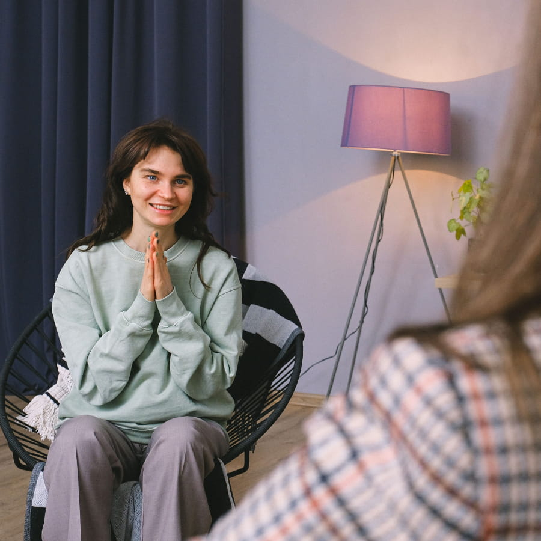

<Section variant="default" tone="paper">

## Has An Anxious Mindset Become Your Norm?

-   Do you regularly experience overwhelming feelings of dread, panic, or the sense that something’s *wrong*? 
-   Is your tendency to be “on” at all times making it impossible for you to relax or feel at ease?
-   Are you so exhausted managing daily fears and stressors that you have no room left for anything—or anyone—else at the end of the day?

Living with chronic anxiety often translates to operating in survival mode. Instead of feeling genuine connection or motivation to get things done, adrenaline pushes you through the day in a way that makes it feel like you’re just going through the motions of life. The blare of internal alarm bells distracts you from being able to do just about anything else, including concentrating on tasks or feeling confident in the decisions you make.

Your relationships are likely suffering too. Without the ability to feel present and “tuned in,” you may be experiencing more conflict and less connection. You want to give the impression that everything is fine on the surface, but inside, it feels like you’re drowning in feelings of stress, worry, and burnout. And that’s not your fault. Anxiety and stress have used up all your energy, so there’s nothing left over for the people you care about.

</Section>

<Section variant="default" tone="tint">

### Why Outside Changes Don’t Fully Fix Anxiety

So you keep waiting. “Tomorrow will be better. Once this project is done, I’ll have more energy.” Or for a student: “Once this test is over, once this semester ends, I’ll feel like myself again.” But tomorrow rarely feels different—because the real problem was never the deadline, the test, or the schedule. It’s the way you’ve learned to respond to them.

That’s why outside changes—a new job, a lighter class schedule, a nicer teacher—don’t fully fix it. The situation changes, but the habit stays the same. And so does the exhaustion.

At Trauma Healing Therapy, we know that you’re smiling through the pain of anxiety, maybe convinced that you don’t need help or that counseling won’t work. But in the safe space of therapy, you can come exactly as you are—without the need to “fix,” overthink, or people-please your way through problems, and we will get to the root of it with you!

<CtaPair />

</Section>

<Section variant="default" tone="paper">

### Anxiety Is Particularly Prevalent In Our Success-Driven Community

Anxiety is one of the most common human struggles as is. Add the relentless, hyper-productive mindset of Silicon Valley’s “hustle culture” to the mix, and it’s no wonder people here feel overworked and under-rested. The relatively recent onset of AI is only intensifying this mindset as many individuals worry about layoffs, market volatility, and an uncertain future for the industry.

If that wasn’t enough already, a lot of our clients also experience the compounded stress of managing a hypercompetitive school environment for their kids. In our community of high-powered, successful professionals, there is a nearly inescapable pressure for our kids to perform academically, athletically, and/or socially—often made worse by the comparison culture generated on social media.

Anxiety is *not* a weakness or character flaw; it’s a signal that you may be stuck in a maladaptive pattern. Anxiety is the symptom of something bigger and deeper going on inside of you that you have learned and internalized growing up. And most times, our clients have tried to treat the symptom (anxiety) instead of the root cause of it (where and when did you learn that if you do not overperform, you are not good enough?). 

Luckily, through the process of therapy with us, you can connect your anxiety symptoms to the real cause underneath it, reduce your stress level and anxiety and live a more connected and balanced life.

</Section>

<Section variant="form" tone="dark">

<ContactForm slot="media" />

## Have any questions? Send us a message!

</Section>

<Section variant="default" tone="paper">

## Trauma Healing Therapy Provides Anxiety Treatment That Is Effective, Collaborative, And Evidence-Based

We understand that each client’s journey is different. That’s why our practice does *not* take a one-size-fits-all approach to anxiety treatment, regardless of if we’re working with children, teens or adults in counseling.

Rather, our therapists collaborate with each individual in counseling to understand their unique history and needs, exploring the roots of anxiety instead of just addressing it as a mere symptom. This may include drawing connections between the situations causing stress and anxiety in your life now and the deeper patterns beneath them—attachment and relationship patterns, cultural and familial messaging, and past experiences that shape how you experience anxiety and respond to stressors today. 

Then, tailoring the process to your goals, we use evidence-based treatment approaches to address anxiety at both the mind and body level.

</Section>

<Section variant="default" tone="tint" flip>

### What To Expect

Therapy for anxiety is likely to combine some aspects of the following approaches:

-   **Cognitive Behavioral Therapy (CBT)** to identify your main Negative Beliefs about yourself and the world/people and when did they start emerging/consolidating as core beliefs.
-   **Dialectical Behavior Therapy (DBT)**, which teaches foundational skills for distress tolerance and communication.
-   **Eye Movement Desensitization and Reprocessing (EMDR)** to heal the core stressful (or traumatic) wounds that have led to anxious patterns and fear-based thinking.

Through the therapy process, you will not only learn how to calm surface-level anxiety symptoms—you’ll learn where anxiety *actually* comes from, which will result in relief that runs deeper and lasts longer. 

While other counseling practices rely primarily on skills for managing distress and anxiety, our approach works because it looks at the root causes of stress, trauma, and their effect on anxiety.

### Healing Is Possible

Trauma Healing Therapy provides highly collaborative, trauma-informed counseling to teens struggling with aspects of anxiety, depression, low self-esteem, trauma, and/or relationship conflict. [Schedule a free consultation](https://traumahealingtherapy.janeapp.com/) with one of our teen therapists or [contact us](/contact-us/) for more information. 

We have office locations in San Francisco and Cupertino, CA and are available for online therapy to residents throughout California.

<CtaPair />

</Section>

<Section variant="faq" tone="sand">

## Common Concerns About Therapy For Anxiety…

<Faq question="Isn’t therapy just an expensive and unnecessary solution to a problem I can solve on my own?">

We absolutely agree that therapy is an investment and that cost is a real consideration when deciding whether or not to pursue treatment—but it’s important to remember that when patterns of anxiety are deeply ingrained, they can be difficult to overcome on your own.

While we are a fully out-of-network practice, some clients do qualify for out-of-network benefits, so make sure to visit [our Mentaya page](https://app.mentaya.com/b/o0REePusDeDgQe41bfKn) to calculate your costs. Additionally, there are a limited number of reduced fee spots available that each clinician offers to people struggling financially. Please connect with us and we will help you find a way to receive the treatment you deserve. 

As a collaborative practice, we center anxiety therapy around *your* goals no matter how big or how small. That means we can individualize treatment to your needs, budget, and time constraints—just 8 to 12 sessions may be enough to make a huge difference in your life.

</Faq>

<Faq question="Will I have to be in therapy for a long time to see improvement in my symptoms?">

We know that many clients have tried to treat their symptoms in counseling in the past, only to continue struggling with anxiety. In these cases, clients are often treated with surface-level (symptom reduction approach) or talk therapy approaches that don’t meaningfully address the root cause of their struggles.

Our treatment philosophy works because it actually helps you address what’s driving the anxiety (i.e root causes) instead of just talking around the problem/giving you skills to cope with it. Especially when we use techniques like EMDR—which actually rewire the nervous system’s response to triggers—clients often experience noticeable relief within a few sessions.

</Faq>

<Faq question="Do your therapists have a lot of experience treating anxiety?">

As a team of highly trained and seasoned therapists, we treat a range of common concerns, including anxiety. Each one of our clinicians is trained in evidence-based, stress and trauma-informed approaches (including CBT, DBT, and EMDR, among others) with a particular focus on treating chronic stress and anxiety.

Whether your challenges stem from career stress, academic pressure, relationship dysfunction, or past trauma, you can feel confident knowing that you’re working with anxiety *specialists* and not just general practitioners.

</Faq>

</Section>

<Section variant="closing" tone="dark">

## Anxiety Doesn’t Have To Be The Norm

Trauma Healing Therapy focuses on healing the *root* of anxiety, allowing you to reprocess challenging thoughts, emotions, and experiences in a way that doesn’t lead to ongoing stress. For more information or to schedule a consultation with one of our anxiety specialists, contact us.

<CtaPair />

</Section>
